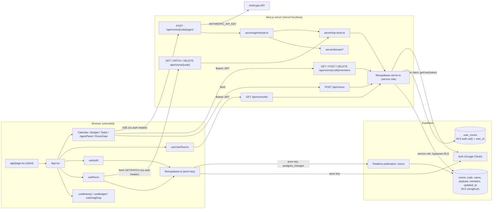

# TravelWith Architecture

Audited at HEAD `9049c34`. Sections "Patterns", "Anti-patterns" and "Dead code" are filled in P8 and P9.

## Map

### Layers

| Layer | Files | Notes |
|---|---|---|
| Entry | `src/app/page.tsx`, `src/app/layout.tsx` | `page.tsx` is `"use client"` and only renders `<App />`. No server components, no routes besides `/`. |
| Orchestrator | `src/App.tsx` (390 lines) | Owns all trip state not held by domain hooks (`tasks`, `tripSpans`, `mockPeople`, `trip`), the 600ms autosave effect, and prop-drills into every view. |
| Domain hooks | `src/hooks/useItinerary.ts`, `useBudget.ts`, `useDragDrop.ts` | Client-side mutation logic for days/events and extras. |
| Persistence hooks | `src/hooks/useRoom.ts`, `useAuth.ts`, `useUserRooms.ts` | `useRoom` = initial GET + PATCH save + Realtime subscription. `RoomPayload` type is defined here (`useRoom.ts:10`). |
| Views | `src/components/{calendar,budget,tasks,editor,agent,auth}/*`, `RoomGate.tsx`, `AppHeader.tsx` | `RoomGate` handles sign-in, trip list, create and join. |
| API routes | `src/app/api/rooms/route.ts`, `list/route.ts`, `[code]/route.ts`, `[code]/members/route.ts`, `[code]/agent/route.ts` | All use `createServerClient()` (service role). |
| Server domain | `src/server/domain/{core,events,extras,tasks,read}.ts` | Pure `(payload, args) -> {payload, result}` functions; `domain.test.ts` covers them. |
| Persistence gateway | `src/server/trip-store.ts` | `loadRoom`, `persistRoom` (no concurrency guard), `mutateRoom` (CAS on `updated_at`, 1 retry). |
| Agent | `src/server/agent/{prompt,tools}.ts` | 13 tools: 3 read, 10 write (see P6). |
| Supabase clients | `src/lib/supabase.ts` (browser, anon key), `src/lib/supabase-server.ts` (service role, falls back to anon key) | |
| Schema | `supabase/migrations/001_init.sql`, `002_trips.sql`, `003_user_rooms_last_active.sql` | `rooms` (open RLS, in `supabase_realtime`), `user_rooms` (own-row RLS). |

### Component and trust-boundary diagram

### Trust boundaries

| # | Boundary | Credential crossing it | Who can cross | Observation |
|---|---|---|---|---|
| TB1 | Browser -> Next.js API | None for `GET/PATCH /api/rooms/[code]`, `POST /api/rooms`, `GET /members`, `POST /agent`. Bearer Supabase JWT for `list`, `POST/DELETE /members`, `DELETE /[code]`. | Anyone on the internet | Room code is the only capability for reading, overwriting, and running the agent on a trip. |
| TB2 | Browser -> Supabase (anon key) | `NEXT_PUBLIC_SUPABASE_ANON_KEY` (public by design) | Anyone who loads the page | Realtime subscription and Auth. The anon key can also hit PostgREST directly, where `rooms` RLS is `using (true)` (`001_init.sql:24-26`). Verified in P4. |
| TB3 | Next.js -> Supabase (service role) | `SUPABASE_SERVICE_ROLE_KEY` | Server only (`lib/supabase-server.ts:21-31`) | Bypasses RLS entirely, so authorization must be enforced in route code. Falls back to anon key if unset (`supabase-server.ts:31`). |
| TB4 | Next.js -> Supabase Auth | User JWT verified via `getUserFromToken` (`supabase-server.ts:35-39`) | Server | Used only by the 4 authenticated handlers. |
| TB5 | Next.js -> Anthropic | `ANTHROPIC_API_KEY` | Server only | Invoked from `agent/route.ts:67` for anyone who can reach TB1 with a valid-format code. |
| TB6 | Model output -> tool executor | Tool calls from the model | Model, steered by chat input and by trip content returned from read tools | Every write tool mutates the room via `mutateRoom`. Analyzed in P6. |

### Data flows

**Create room**
1. `RoomGate.create()` (`RoomGate.tsx:66-91`) POSTs `{name, destination, startDate, endDate}` to `/api/rooms` with no auth header.
2. `api/rooms/route.ts:16-65` validates, builds days server-side, generates code with `Math.random().toString(36).slice(2, 8)` (`route.ts:9`), inserts with service role, retries on 23505.
3. Client then calls `registerMember(code, "owner")` (`RoomGate.tsx:88`) -> `POST /api/rooms/[code]/members` with body `{role:"owner"}`. The server trusts the body role (`members/route.ts:92`: `if (body?.role === "owner") role = "owner";`).

**Join room**
1. `RoomGate.join()` GETs `/api/rooms/[code]` unauthenticated to check existence (`RoomGate.tsx:54`).
2. `POST /members` with `{role:"member"}`: appends to `rooms.members` JSONB (read-modify-write, no guard) and inserts/touches `user_rooms`.

**Load and edit event, autosave, Realtime sync**
1. `useRoom` effect GETs `/api/rooms/[code]`, seeds state via `onRemoteUpdate`, sets `skipSave`, stores `updated_at`, sets `connected` (`useRoom.ts:84-98`).
2. Subscribes to `postgres_changes` UPDATE on `rooms` filtered `code=eq.<code>` using the anon key (`useRoom.ts:102-119`).
3. Edits mutate hook state; `App.tsx:170-181` debounces 600ms then `save(fullPayload)`.
4. `save` PATCHes full payload plus `expectedUpdatedAt` (`useRoom.ts:48-52`). Server compares then calls `persistRoom` (`[code]/route.ts` PATCH). The compare and the write are two separate statements, so the check is not atomic (candidate race, P5/P10).
5. On 409 the client adopts the server payload (`useRoom.ts:54-64`): local unsaved edits are discarded.
6. Other members receive the UPDATE row via Realtime and replace their state.

**Agent tool call mutating the room**
1. `AgentPanel` POSTs `{messages:[{role,content}]}` to `/api/rooms/[code]/agent` with no auth (`AgentPanel.tsx:66-69`).
2. Route replays client-supplied history, including `assistant` turns, into `messages.create` (`agent/route.ts:55-58`).
3. For each `tool_use`, `executeTool(code, ...)` (`tools.ts:212`) runs a domain function inside `mutateRoom` (CAS on `updated_at`, one retry).
4. The write fires Realtime, so all members' clients reload the payload. If a member has a pending debounced save, its next PATCH carries a stale `expectedUpdatedAt` and gets 409, so the member's in-flight edit is dropped in favor of the agent's write.

### Recon observations (leads for later phases, logged in FINDINGS.md as Open)

- Room read/write/agent access requires only the 6-char code; no auth on `GET/PATCH /api/rooms/[code]` or `/agent`.
- Client-chosen `role:"owner"` on `POST /members` combined with owner-only hard `DELETE /api/rooms/[code]`.
- `rooms.members` column is used by 4 handlers and `trip-store.ts` but is not created by any migration (schema drift).
- `createServerClient` silently degrades to the anon key.
- `RoomPayload` is defined in a client hook and imported by server code (`api/rooms/route.ts:6`, `trip-store.ts:2`, `lib/validate.ts:1`).

## Patterns (P8, iteration 8)

Verification at HEAD `9049c34`: `npx tsc --noEmit` exit 0; `npx vitest run` 3 files, 31 tests passed.

### Keep

| Pattern | Evidence | Why it matters for multi-user |
|---|---|---|
| Pure server domain layer `(payload, args) -> {payload, result}` with `DomainError` | `src/server/domain/*.ts`, `domain.test.ts` | Ideal seam for moving all writes server-side; already unit-tested. |
| CAS persistence in `mutateRoom` | `src/server/trip-store.ts:57-82` `.eq("updated_at", updatedAt)` + retry | Correct concurrency primitive; extend to every writer. |
| Server-built initial payload | `src/app/api/rooms/route.ts:32-45` | Demo data never leaks into real rooms. |
| Optional fields with read-time defaults | `types/index.ts` (`splitMode?`, `dayId?`), `onRemoteUpdate` `Array.isArray` guards (`App.tsx:137-144`) | Old payloads keep loading; safe for evolving shared data. |
| Money math centralized | `utils/currency.ts` + `currency.test.ts` | One source of truth for per-person splits. |
| Byte-stable agent system prompt, tools bound to room | `server/agent/prompt.ts:1-11`, `executeTool(code, ...)` | Cheap cached calls; no cross-room reach. |
| Secrets confined to server modules | `lib/supabase-server.ts`, agent route | Verified in P7. |

## Anti-patterns (P8, iteration 8)

| ID | Anti-pattern | Evidence | Why it hurts multi-user | Recommended pattern | Effort | Risk of change |
|---|---|---|---|---|---|---|
| ARCH-001 | Dual write paths with duplicated, diverging business logic | Client writes full payload via PATCH (`App.tsx:170-181`) using hook logic (`useItinerary.ts:65-81`); server writes via domain (`server/domain/events.ts:97-109`). Client `deleteEvent` does not unlink expenses, server does; client `addEvent` skips hour/title validation and defaults `cat = "miami"` | Invariants hold only for agent writes; any member's client can persist states the domain would reject; authorization per action is impossible when the unit of write is "the whole trip" | Move to command-style writes: client sends `{op, args}` to `POST /api/rooms/[code]/ops`, server applies the same domain function inside `mutateRoom`, Realtime broadcasts. Migrate one domain at a time; keep PATCH during transition behind CAS | L | Medium: touches every editor, but domain functions already exist |
| ARCH-002 | Server imports its core type from a client hook | `RoomPayload` defined in `src/hooks/useRoom.ts:10-18`, imported by 10 server/lib files (`trip-store.ts:2`, `server/domain/*.ts:1`, `agent/tools.ts:2`, `lib/validate.ts:1`, `api/rooms/route.ts:6`) | Server bundle depends on a React hook module; violates GUIDELINES "all domain types in `src/types/index.ts`" | Move `RoomPayload` and `MockPerson` to `src/types/index.ts`, re-export from `useRoom` for compatibility | S | Low (type-only) |
| ARCH-003 | Whole trip as a single JSONB document | `rooms.payload jsonb` (`001_init.sql:4`); every save sends and broadcasts the full document (`useRoom.ts:48-52`, Realtime row) | Conflict unit is the whole trip; no per-entity permissions (e.g. private expenses), no history/audit, cost of each save grows with trip size, Realtime fan-out sends everything to everyone | Short term: keep JSONB but add `room_snapshots` (append-only, last N per room) and `updated_by`. Long term: normalize high-churn entities (events, tasks, extras) only if per-entity permissions are required | M (snapshots) / L (normalize) | Medium |
| ARCH-004 | `App.tsx` as god component with domain logic inline | 390 lines (limit ~400); task CRUD and `chooseTaskOption` (`App.tsx:86-122`), trip spans (`:75-77`), travelers (`:79-84`) live in `App` instead of hooks; `BudgetPanel` takes 21 props (`BudgetPanel.tsx`) | Every new collaborative feature lands in the same file; prop drilling makes per-user UI state (roles, permissions) hard to thread | Extract `useTasks`, `useTripSpans`, `useTravelers` per GUIDELINES "one hook per domain"; add a `RoomContext` for room-wide values (`people`, `exchangeRate`, `days`, role) | M | Low with typecheck |
| ARCH-005 | Next.js App Router used as a single client SPA | `src/app/page.tsx:1` `"use client"`, only route `/`; room code held in React state, not the URL (`App.tsx:31`) | No deep links per trip, no server-side auth gate for pages, no SSR of trip metadata, whole app in one bundle | Add `app/trip/[code]/page.tsx` with a server component that checks membership before rendering the client tree; keep `App` as the client island | M | Medium |
| ARCH-006 | No server auth/authorization module | Token parsing duplicated in 4 handlers (`list/route.ts:17`, `members/route.ts:34,83`, `[code]/route.ts:35`); membership never checked except owner delete | Each new route must re-implement auth; easy to forget (it already was for 5 handlers) | `src/server/auth.ts` with `requireUser` / `requireMember` (sketch in FINDINGS Details P5) | S | Low |
| REL-007 | Echo and skip-flag handling loses local edits | Single boolean `skipSave` (`useRoom.ts:36,42-45`) is consumed by the next save regardless of origin; own-save Realtime echo replaces local state (`useRoom.ts:107-113`) | Remote update followed by a user edit within 600ms: the debounced save carrying the edit is skipped. Edit made after a save is sent but before its echo arrives: echo overwrites it locally | Compare `updated_at` of incoming rows with the last one this client wrote and ignore own echoes; track a dirty version counter instead of a boolean skip | S | Low |
| DX-004 | Critical paths have no tests | Tests exist only for `server/domain`, `utils/currency`, `utils/tripDays` (FEATURES.md "Test coverage summary"); none for API routes, `trip-store`, `validate`, agent loop, hooks | Multi-user fixes (authz, CAS, validation) will change exactly the untested code | Add route-handler tests with a mocked Supabase client, `validate.ts` table tests, `mutateRoom` conflict tests, agent loop test with a stubbed Anthropic client | M | None |

Minor: `react-hooks/exhaustive-deps` disabled twice (`useRoom.ts:125`, `App.tsx:180`) and `loadDays` is not memoized, so `onRemoteUpdate` changes every render while the Realtime handler keeps the first one. Currently harmless (setters are stable) but fragile.

## Dead code and cleanup (P9, iteration 9)

Nothing was deleted; this is a list. Verdicts: DELETE, REPLACE, KEEP.

| Item | Evidence | Verdict | Finding |
|---|---|---|---|
| `src/utils/clonePlan.ts` | `export {};` stub, no importers | DELETE | DEAD-001 |
| `useItinerary.addDaySpan` | no caller | REPLACE (wire UI) or DELETE | DEAD-002 |
| `src/assets/hero.png`, `react.svg`, `vite.svg`; `public/icons.svg` | zero references | DELETE | DEAD-003 |
| `public/favicon.svg` | not linked from metadata | REPLACE with `src/app/icon.svg` | DEAD-003 |
| `README.md` stack section | says Vite, `App.jsx`, "CSS variables inline" | REPLACE | DEAD-004 |
| `components/ui/{label,select,separator,table,tabs}.tsx` | 0 importers | DELETE (or KEEP if planned) | DEAD-005 |
| `tsconfig.tsbuildinfo`, `.claude/settings.local.json` | tracked, not ignored | DELETE from index + `.gitignore` | DEAD-006 |
| `data/initialDays.ts`, `DEFAULT_EXTRAS` in `useBudget.ts` | initial state of production hooks; reset fallback | REPLACE (empty state; demo behind dynamic import) | DEAD-007 |
| `data/mockRoom.ts` | bundled in production although `LOCAL_MODE_ENABLED` is false there | REPLACE (dynamic import) | DEAD-007 |
| `AppHeader` `DEMO` constant | trip-specific eyebrow and dates | REPLACE (generic demo) | DEAD-007, DEAD-008 |
| Categories `barco`, `puerto`, `miami` and default `"miami"` (5 places) | cruise-specific | REPLACE by adding generic keys; KEEP old keys for old payloads | DEAD-008 |
| `RoomPayload.mockPeople` field name | persisted field | KEEP (golden rule: never rename); relabel in UI only | none |
| Exported arg types used only in-file (`AddEventArgs`, `UpdateEventArgs`, `AddExtraArgs`, `UpdateExtraArgs`, `AddTaskArgs`, `UpdateTaskArgs`, `LoadedRoom`, `ToolOutcome`, `SpanColor`, `TaskCategory`), `serviceRoleKey` | no external importers | KEEP (public surface of domain/persistence modules; harmless) | none |
| `DayTimeline.perDayUSD`, `linkedDay` | exported, used only inside `DayTimeline.tsx` | KEEP, or move to `utils/currency.ts` if reused | none |

## Scalability, reliability, data integrity (P10, iteration 10)

### Load model per edit
- Every state change triggers one `PATCH /api/rooms/[code]` 600ms after the last change (`App.tsx:170-181`), carrying the **whole payload**. The server does 1 read (when `expectedUpdatedAt` is sent) plus 1 full-row update (`[code]/route.ts:90-109`), and Realtime pushes the whole new row to every subscribed member (`useRoom.ts:102-119`).
- Payload size: the demo trip (9 days, 53 events, about 14 KB of source in `data/initialDays.ts` + `data/mockRoom.ts`) serializes to roughly 10-20 KB. A 60-day trip (`MAX_TRIP_DAYS`, `tripDays.ts:6`) with long notes can plausibly reach a few hundred KB. There is no cap (SEC-API-004).
- Bytes per edit is about `payload x (1 upload + N member broadcasts)`, and Postgres rewrites the whole TOASTed JSONB value each time, so WAL and egress grow linearly with trip size times edit rate times members.
- Every member's client also re-renders the full trip on each remote update (`onRemoteUpdate` replaces all state, `App.tsx:137-144`).

### Realtime fan-out
- One channel per open room (`room-${code}`) with a `code=eq` filter. Postgres Changes evaluates RLS per subscriber per change; with the P4 membership policy this becomes a `user_rooms` lookup per change per subscriber, still fine at small scale. The primary scale risk is today's unfiltered leak (SEC-DATA-002), not throughput.
- For larger rooms, Supabase Broadcast of small diffs (from the command-style writes in ARCH-001) would cut fan-out size by orders of magnitude.

### Failure handling
| Scenario | Current behavior | Evidence | Gap |
|---|---|---|---|
| Initial GET fails (network, 5xx) | `connected` stays false forever, no retry; UI keeps demo/empty state; autosave disabled | `useRoom.ts:84-98` `.catch(() => setConnected(false))` | User edits locally with a grey dot and loses them on reload (REL-008) |
| Save fails | `saveState = "error"`, no retry until the next edit | `useRoom.ts:66-76` | Last edit before closing the tab can be lost silently (REL-008) |
| Realtime drops and reconnects | supabase-js reconnects, but subscription status is never observed and missed changes are never refetched | `useRoom.ts:119` `.subscribe()` with no status callback | Stale client state; next save hits 409 and discards local edits (REL-004 path) (REL-008) |
| Offline | No offline queue, no local persistence | no `localStorage`/IndexedDB use in `src/` | Edits lost on reload |
| 409 conflict | Adopt server payload, drop local edits | `useRoom.ts:54-64` | No merge, no user notice (REL-003, REL-004) |
| Mistaken overwrite or reset | No history, no restore path | `rooms` has one `payload` column | Relies on Supabase backups/PITR, whose plan level is unknown (ARCH-003, REL-002) |

### Observability
- One `console.*` call in `src/` (the service-role warning, `supabase-server.ts:24`). No error tracking, no structured logs, no analytics, no alerting. Agent token usage is sent to the client in the `done` frame and never stored (`agent/route.ts`). There is no way to detect abuse, cost spikes, or save failures in production (REL-009).

### Cost model per active user (qualitative; price it with current Supabase, Vercel and Anthropic rates)
| Provider | Driver | Scales with | Dominant? |
|---|---|---|---|
| Anthropic | Agent requests: up to 15 calls x (cached system + tools + history + tool results) input, up to 8,192 output each | agent messages per user, trip size (read tools return full day/budget), history length | Yes, by far, and currently uncapped (SEC-AI-001) |
| Vercel | 1 function invocation per autosave, per GET, per join; long-lived SSE for agent runs (Fluid Compute active CPU) | edit rate per active member | Low to medium |
| Supabase DB | Full-row rewrites and WAL, storage about 10-300 KB per trip | edits x payload size | Low |
| Supabase Realtime | Messages = saves x members in room; each message carries the full row | edits x members x payload size | Medium for larger groups |
| Supabase Auth | Monthly active users | users | Low |
