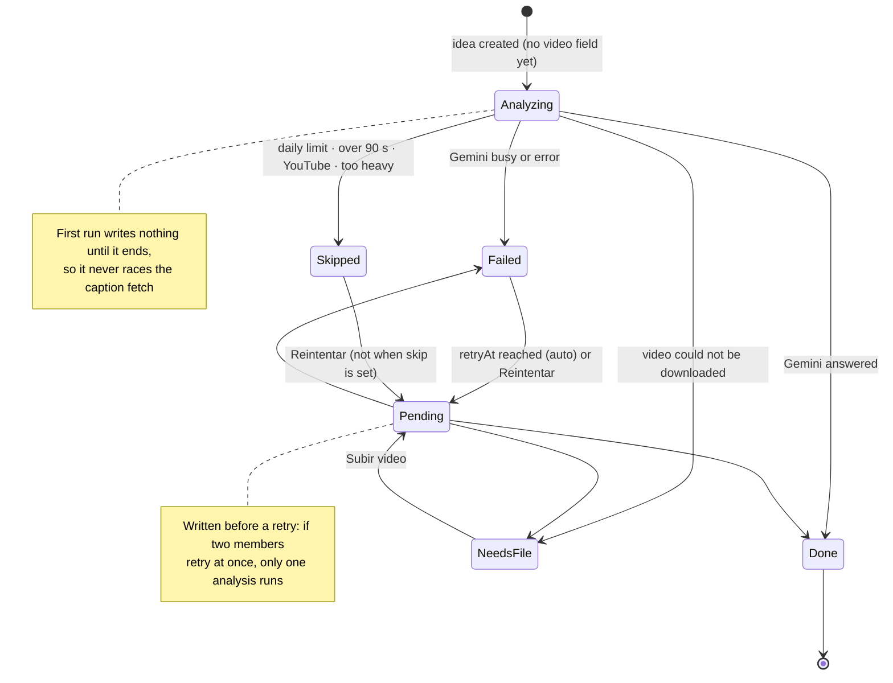
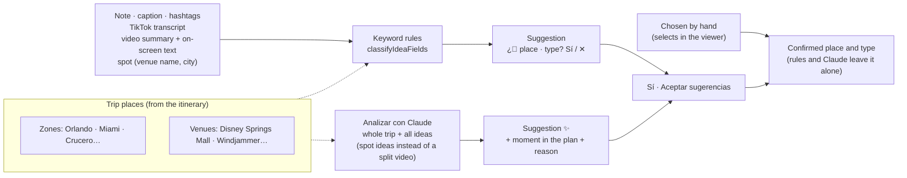
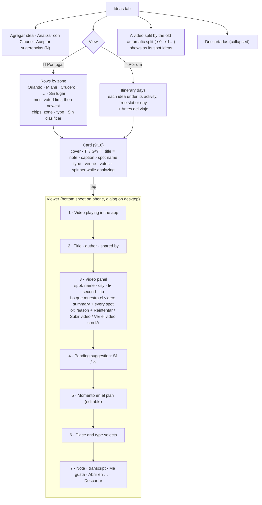

# Ideas: flow and views

How a shared video becomes ideas, how they are classified and how the board shows them. Code: `src/components/ideas/`, `src/hooks/useIdeas.ts`, `src/server/video/`, `src/server/ideaPlan.ts`.

## 1. End to end

```mermaid
flowchart TD
  subgraph In["Entry points"]
    Form["Agregar idea<br/>(links + optional note)"]
    Share["Phone share<br/>Android share_target · iOS Shortcut → /?share="]
    Agent["Assistant add_idea<br/>(after the approval card)"]
    Old["Ver el video con IA<br/>(ideas saved before the feature)"]
  end

  Form --> Create
  Share --> Form
  Agent --> Create
  Create["op idea.create<br/>optimistic in the browser"] --> Row[("trip_ideas")]
  Row -- "Broadcast trip:&lt;code&gt;" --> Members["Every member's board"]

  Create --> Meta["Browser: /oembed<br/>caption · author · cover · TikTok transcript<br/>(1–3 s)"]
  Meta --> Row

  Create -- "after() — server, after the response" --> Analyze
  Old --> Analyze

  subgraph Server["Video analysis (30–120 s)"]
    Analyze["analyzeIdeaVideo"] --> Quota{"Daily limit<br/>reached?"}
    Quota -- yes --> Skipped["video.status = skipped"]
    Quota -- no --> Source{"Source"}
    Source -- "YouTube" --> NoYT["video.status = skipped · skip = platform<br/>(length unknown before watching)"]
    Source -- TikTok --> DL["Download from the page<br/>(playAddr + cookies)<br/>duration checked first"]
    Source -- Instagram --> Apify["Apify actor → CDN MP4<br/>duration checked first"]
    DL & Apify -. "longer than 90 s" .-> TooLong["video.status = skipped · skip = tooLong<br/>no Reintentar"]
    Source -- "upload" --> Bucket["Private bucket idea-videos<br/>length checked in the browser<br/>(deleted afterwards)"]
    DL & Apify & Bucket --> Files["Gemini Files API<br/>(deleted afterwards)"]
    Files --> Gemini["Gemini watches image + audio<br/>main model → retry → fallback<br/>270 s budget"]
    Gemini --> Parse["Validate: summary · on-screen text<br/>relevant · spots (name, city, type, second, price, tip)<br/>insights (todo · tip · avoid · fact, when, hours, second)"]
    Parse --> Write["apply_idea_video (one transaction)<br/>merged onto the latest idea"]
    Write --> Parent["Parent: video = done + summary + spots + insights"]
    Parent -. "Guardar como idea (a member, per spot)" .-> Children["Spot idea     Write --> Children["≥ 2 spots → one child idea per spot<br/>(parentId, own suggestion)"]lt;video    Write --> Children["≥ 2 spots → one child idea per spot<br/>(parentId, own suggestion)"]gt;-s-    Write --> Children["≥ 2 spots → one child idea per spot<br/>(parentId, own suggestion)"]lt;name    Write --> Children["≥ 2 spots → one child idea per spot<br/>(parentId, own suggestion)"]gt;<br/>(parentId, own suggestion)"]
    Gemini -. busy / error .-> Failed["video.status = failed<br/>retryAt → any member's app retries (max 3)"]
    Source -. "no video" .-> NeedsFile["video.status = needsFile<br/>→ Subir video"]
    Analyze --> Usage[("video_usage<br/>tokens · cost · time")]
  end

  Parent & Children --> Row
```

## 2. States of a video analysis



## 3. How an idea gets its place and type



Spot ideas pick their place in this order: the member's note, a venue of the plan named by the spot, the spot's city when it is a trip place, then the other text.

## 4. The board



Ideas never change the calendar: moving one into the itinerary is always a member's action, by hand or through the assistant.
